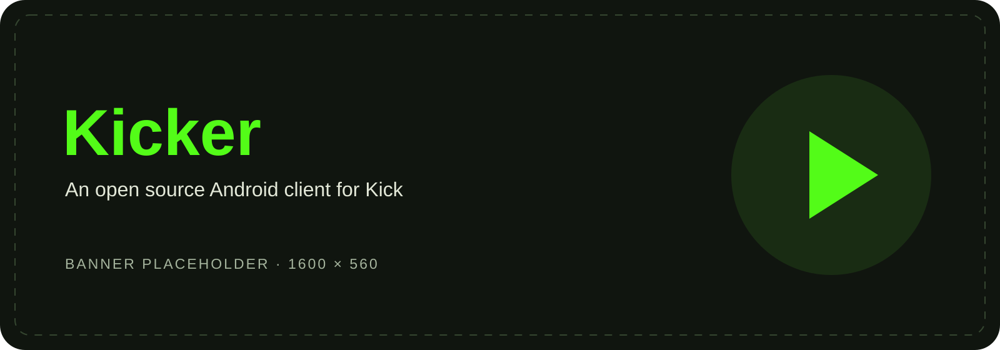
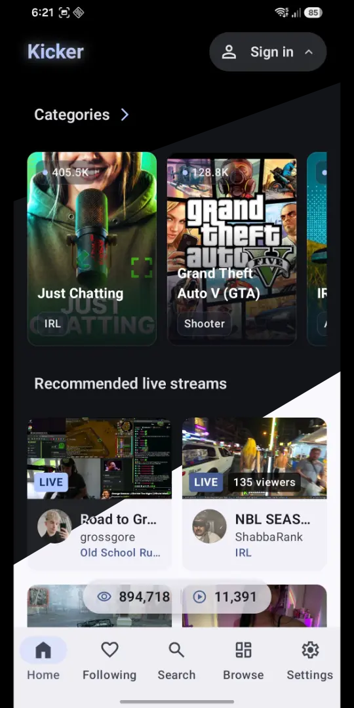
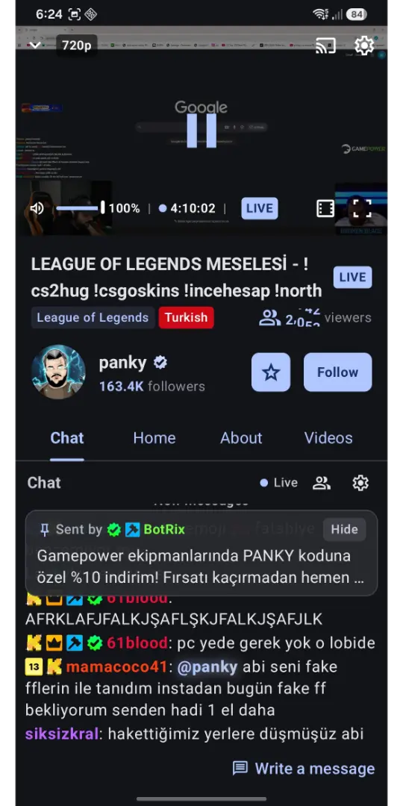
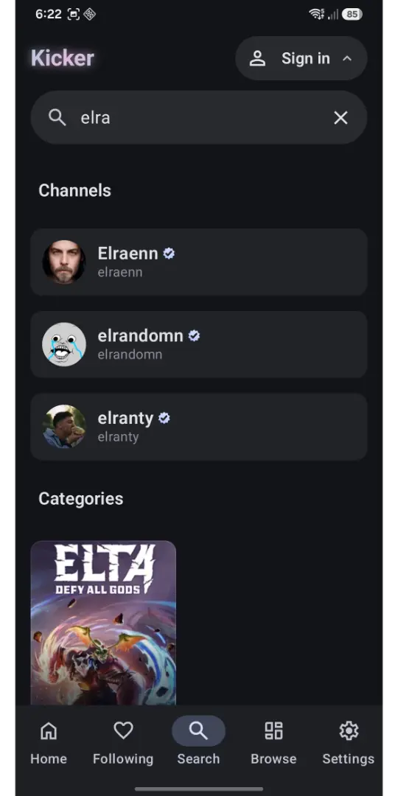
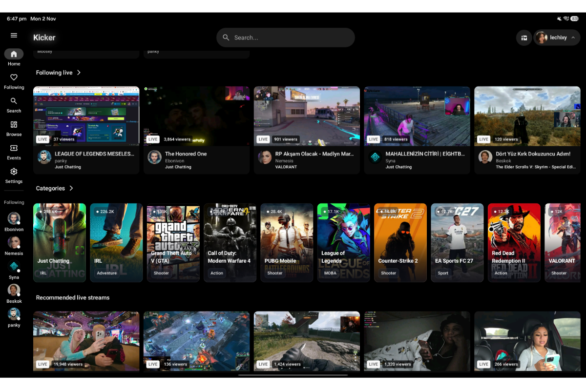
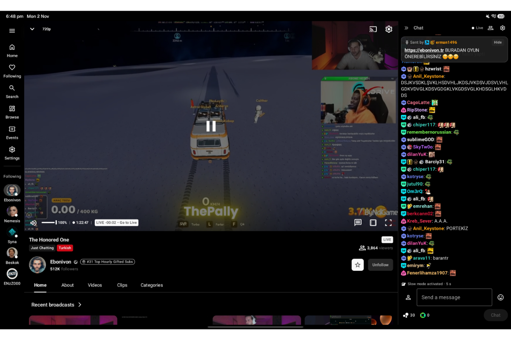

[//]: # (<p align="center">)

[//]: # (  )

[//]: # (</p>)

<h1 align="center">Kicker</h1>

<p align="center">
  A free and open source Android client for Kick 💚<br>
  Native Material 3 design. Live streams, chat, and VODs. Built for phones and tablets.
</p>

<p align="center">
  <strong>English</strong> • <a href="README.tr.MD">Türkçe</a>
</p>

<p align="center">
  <a href="LICENSE"></a>
  <a href="app/build.gradle.kts"></a>
  <a href="https://github.com/lechixy/Kicker/releases"></a>
  <a href="https://github.com/lechixy/Kicker/releases"></a>
  <a href="https://github.com/lechixy/Kicker/issues"></a>
</p>

<p align="center">
  <a href="#how-to-install">Download</a> •
  <a href="#features">Features</a> •
  <a href="#screenshots">Screenshots</a> •
  <a href="https://app.notion.com/p/lechixy/3f79ce1d06e580d99d7ac8f36ea9b953?v=2689ce1d06e58207971c0840ab5893c6&amp;source=copy_link">Roadmap</a> •
  <a href="#contributing">Contribute</a>
</p>

## Why Kicker?

Kicker was created to address the stuttering, lag, excessive device heating, and instability experienced with the official Kick Android app. The goal is a smoother, more dependable viewing experience with a native interface and controls that feel at home on Android. Performance and battery use still depend on your device, stream quality, and network.

> [!IMPORTANT]
> **Independent, unofficial project.** Kicker is not affiliated with, endorsed by, or sponsored by Kick. Kick names, logos, and content belong to their respective owners. The name **Kicker** distinguishes this community client from the official app.

## Features

- **Watch live and recorded streams:** browse channels and categories, search for creators, and watch VODs.
- **Use it without an account:** watch streams, search, play VODs, and read chat as a guest.
- **Connect your Kick account:** access your follows, follow or unfollow channels, and send chat messages.
- **Make playback yours:** automatic or manual quality selection, low-latency mode, picture-in-picture, a mini player, and a sleep timer.
- **Keep your place:** local favorites, watch history, and saved VOD playback progress.
- **Enjoy native Material 3:** adaptive layouts for phones and tablets, light/dark/AMOLED themes, and dynamic colors on Android 12+.
- **Customize chat:** adjust text size, message spacing, timestamps, and chat panel width.
- **View your Kicks balance:** balance display without an in-app checkout or real-money transactions.
- **Choose your language:** English and Turkish, with support for following the system language.

Account features depend on Kick's service availability and may need updates when its web APIs change.

## Goals

- Deliver smooth playback and responsive navigation while reducing unnecessary resource use.
- Offer a consistent, accessible Material experience on small and large screens.
- Keep account connection optional and session storage local to your device.
- Keep development open, reviewable, and welcoming to community contributions.

See the [roadmap and planned work](https://app.notion.com/p/lechixy/3f79ce1d06e580d99d7ac8f36ea9b953?v=2689ce1d06e58207971c0840ab5893c6&source=copy_link). Goals describe the project's direction; they are not guarantees of delivery dates or benchmark results.

## Screenshots
### Phone

<table>
  <tr>
    <td align="center" width="33%"><br><strong>Make it yours</strong></td>
    <td align="center" width="33%"><br><strong>Watch &amp; chat</strong></td>
    <td align="center" width="33%"><br><strong>Discover</strong></td>
  </tr>
</table>

### Tablet

<table>
  <tr>
    <td align="center" width="50%"><br><strong>Discover on a larger screen</strong></td>
    <td align="center" width="50%"><br><strong>Player &amp; chat, side by side</strong></td>
  </tr>
</table>

<!-- Replace the SVG placeholders with real captures and update each src above.
     Suggested assets under .github/assets/: banner.png, phone-discover.png,
     phone-player.png, phone-settings.png, tablet-discover.png, tablet-player.png. -->

## How to install

**Requires Android 11 (API 30) or newer.** Package ID: `com.lechixy.kicker`.

<p align="center">
  <a href="https://github.com/lechixy/Kicker/releases"></a>
  <a href="https://search.f-droid.org/?q=com.lechixy.kicker"></a>
  <a href="https://apt.izzysoft.de/fdroid/index.php"></a>
</p>

| Source | Installation |
| --- | --- |
| [GitHub Releases](https://github.com/lechixy/Kicker/releases) | Download an APK from a published release and install it manually. |
| [F-Droid](https://search.f-droid.org/?q=com.lechixy.kicker) | Search for Kicker or its package ID in the F-Droid client. Listing availability is not yet confirmed; use GitHub if it is absent. |
| [IzzyOnDroid](https://apt.izzysoft.de/fdroid/index.php) | Search the repository for Kicker or its package ID. Listing availability is not yet confirmed; use GitHub if it is absent. |

### Install an APK from GitHub

1. Open [Releases](https://github.com/lechixy/Kicker/releases) and read the release notes.
2. Choose a **release** APK for your device: `arm64-v8a` for most current phones, `armeabi-v7a` for 32-bit ARM devices, or `x86`/`x86_64` for compatible Intel devices and emulators. Choose **universal** if you are unsure.
3. If a `sha256sums.txt` file is provided, compare the APK's SHA-256 hash with its entry.
4. Open the APK, allow installation from that source if Android asks, and follow the installer.

For updates, install a newer APK signed with the same certificate. Different distribution channels may use different signing keys, so switching sources can require uninstalling first. Uninstalling removes local app data and the saved session.

### Build from source

Use Android Studio with support for the project's Android Gradle Plugin, JDK 21, and the Android SDK required by [the app build configuration](app/build.gradle.kts). Open the project, let Gradle sync, and run the `app` configuration, or build a debug APK:

```sh
git clone https://github.com/lechixy/Kicker.git
cd Kicker
./gradlew assembleDebug
```

On Windows, use `gradlew.bat assembleDebug`. APKs are written to `app/build/outputs/apk/debug/`. No separate backend or Kick developer application registration is required.

## Notices & privacy

### No real-money transactions

Kicker does **not** process purchases, subscriptions, subscription gifts, Kicks purchases, or other real-money transactions. It only displays your Kicks balance. For all purchases and subscription management, use the [official Kick website](https://kick.com/) or official mobile app.

### Your account stays under your control

- Signing in is optional and happens on Kick's own login page inside the app.
- Kicker does not send your sign-in credentials or session to a developer-operated backend. Authentication communicates directly with Kick; using Kick still involves its own services and privacy practices.
- The retained session is encrypted locally with AES-GCM using a key held in **Android Keystore**. The encrypted session is stored in the app's private, no-backup directory, outside Android backup/device transfer and settings exports.
- Kicker uses that session to authenticate your account actions and maintain the connected Kick experience, including follows, chat, and playback-related requests.
- Signing out clears the app's saved session and account state. Uninstalling removes its local session data and app-scoped Keystore key. To revoke sessions on Kick's side, use Kick's account security settings.

Review the implementation in [SecureSessionStore.kt](app/src/main/java/com/lechixy/kick/data/account/local/SecureSessionStore.kt), [AuthRepository.kt](app/src/main/java/com/lechixy/kick/data/account/repository/AuthRepository.kt), and [KickWebLoginActivity.kt](app/src/main/java/com/lechixy/kick/KickWebLoginActivity.kt).

## Contributing

Bug reports, translations, accessibility improvements, documentation, and code contributions are welcome.

1. Check [existing issues](https://github.com/lechixy/Kicker/issues) and the [roadmap](https://app.notion.com/p/lechixy/3f79ce1d06e580d99d7ac8f36ea9b953?v=2689ce1d06e58207971c0840ab5893c6&source=copy_link) before starting larger changes.
2. For a bug, include the app version and installation source, Android version, device model, steps to reproduce, and expected/actual behavior. Remove cookies, tokens, personal information, and private chat content from logs or screenshots.
3. Fork the repository, make a focused change, and open a [pull request](https://github.com/lechixy/Kicker/pulls) explaining the change and how you verified it.
4. For code changes, run relevant tests (`./gradlew testDebugUnitTest`) and check affected UI on a phone and tablet when applicable. Instrumented tests require a connected device or emulator (`./gradlew connectedDebugAndroidTest`).

Keep both README translations in sync when changing shared documentation.

## Language support

| Language | App interface | README |
| --- | --- | --- |
| English | Supported; default resources in [values](app/src/main/res/values) | [English](README.MD) |
| Türkçe | Supported; translations in [values-tr](app/src/main/res/values-tr) | [Türkçe](README.tr.MD) |

To add a language, translate the relevant `strings*.xml` files into `app/src/main/res/values-<language>/`, preserve resource names and format arguments, and add the locale to [locales_config.xml](app/src/main/res/xml/locales_config.xml) and the language options in [SettingsCatalog.kt](app/src/main/java/com/lechixy/kick/screens/settings/SettingsCatalog.kt). README translations are welcome too; add a language link once its file exists.

## FAQ

### Is Kicker the official Kick app?

No. It is an independent community project. Use Kick's official channels for billing, account recovery, and platform support.

### Do I need to sign in?

No. Watching live streams and VODs, searching, and reading chat work as a guest. Sign in to access your Kick follows and send chat messages.

### Can I buy Kicks or subscribe to a creator?

No. Kicker only shows your Kicks balance and does not handle real-money transactions. Use Kick's website or official app for purchases and subscriptions.

### Where is my session stored?

On your device, encrypted with an Android Keystore key. It is not uploaded to a Kicker backend or included in backups or settings exports. See [Notices & privacy](#notices--privacy) for details.

### Why did login, chat, or a stream stop working?

Kicker depends on Kick's web APIs and WebSocket services. Service changes, expired sessions, outages, or network conditions can affect features. Try the newest release, sign in again if prompted, and report reproducible problems with sensitive information removed.

### Will Kicker always run cooler or use less battery?

Reducing stutter and unnecessary resource use is a development goal, not a guarantee for every device. Stream resolution, decoding hardware, network conditions, and display brightness all affect heat and power consumption.

### Can I switch between GitHub, F-Droid, and IzzyOnDroid builds?

Only builds with matching package IDs and compatible signatures can update one another. If signatures differ, Android requires uninstalling the existing build first, which removes its local data.

## Dependencies

Kicker is built on the work of these open source projects:

| Project | Used for |
| --- | --- |
| [Kotlin](https://kotlinlang.org/) & [kotlinx.serialization](https://github.com/Kotlin/kotlinx.serialization) | Application code and JSON serialization |
| [Jetpack Compose](https://developer.android.com/compose) & [Material 3](https://developer.android.com/jetpack/androidx/releases/compose-material3) | Native UI, themes, and adaptive layouts |
| [AndroidX](https://developer.android.com/jetpack/androidx) | Activity, AppCompat, Lifecycle, Navigation, DataStore, splash screen, and profile installation |
| [Media3 / ExoPlayer](https://github.com/androidx/media) | HLS playback and media sessions |
| [Dagger Hilt](https://dagger.dev/hilt/) & [KSP](https://github.com/google/ksp) | Dependency injection and code generation |
| [Retrofit](https://github.com/square/retrofit) & [OkHttp](https://github.com/square/okhttp) | HTTP APIs and WebSocket connections |
| [Coil](https://github.com/coil-kt/coil) | Image loading and GIF support |
| [Markwon](https://github.com/noties/Markwon) | Markdown rendering |
| [Android Identity Credential](https://github.com/openwallet-foundation-labs/identity-credential) | Identity utilities declared by the app |
| [JUnit](https://junit.org/junit4/), [Espresso](https://developer.android.com/training/testing/espresso), [UI Automator](https://developer.android.com/training/testing/other-components/ui-automator) & [Macrobenchmark](https://developer.android.com/topic/performance/benchmarking/macrobenchmark-overview) | Tests and performance tooling |

For exact coordinates and versions, see [gradle/libs.versions.toml](gradle/libs.versions.toml), [app/build.gradle.kts](app/build.gradle.kts), and [baselineProfile/build.gradle.kts](baselineProfile/build.gradle.kts). Dependencies retain their respective licenses.

## License

Kicker is free and open source software released under the [MIT License](LICENSE). The software is provided without warranty; see the license for its full terms. Third-party trademarks, platform content, and dependencies remain subject to their owners' rights and applicable licenses.
